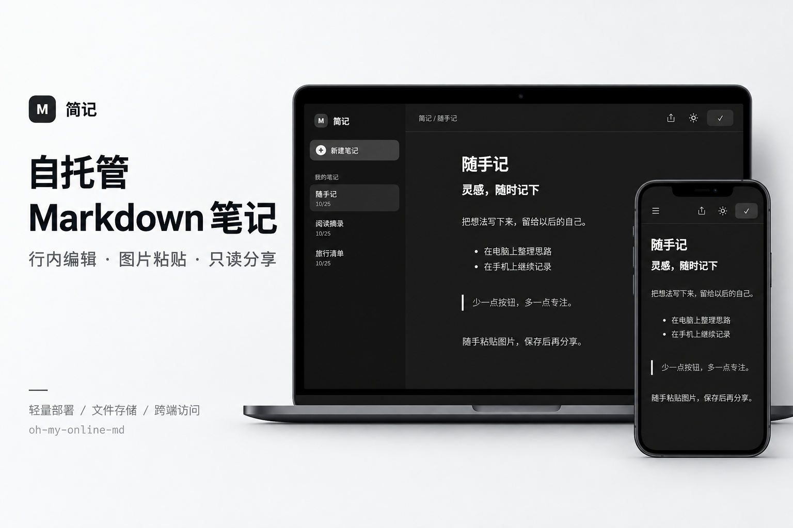
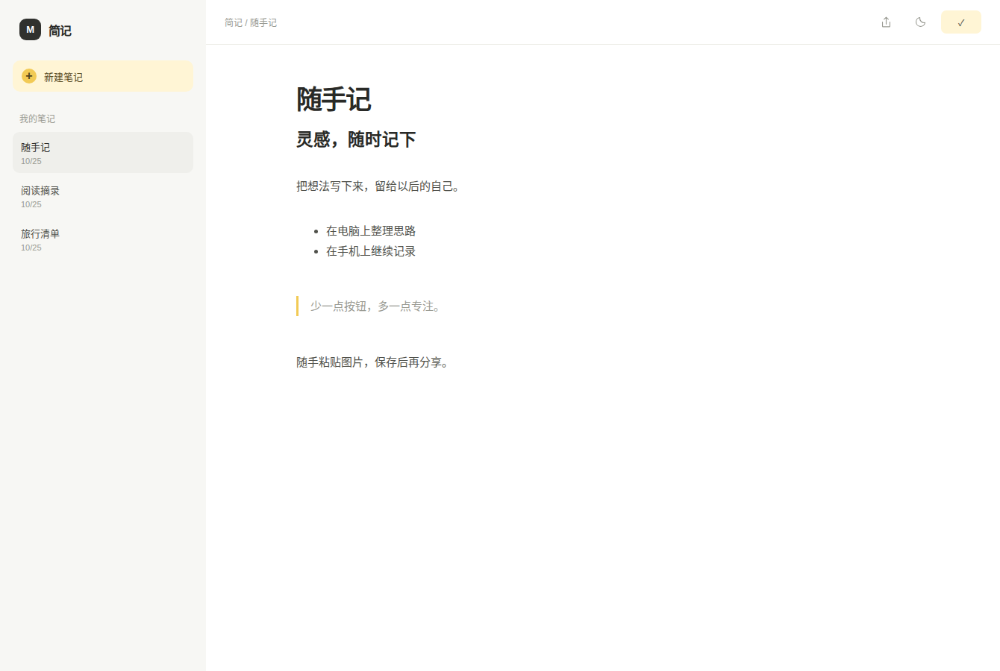
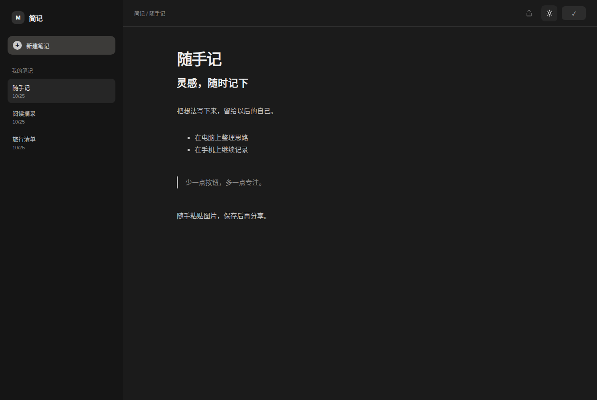

# 简记

[](https://github.com/Nyakooo/oh-my-online-md/actions/workflows/publish.yml)
[](https://github.com/Nyakooo/oh-my-online-md/releases)
[](LICENSE)

**轻量级自托管 Markdown 笔记应用。**

简记提供 Markdown 编辑与预览、图片粘贴、限时只读分享与跨设备访问。服务基于 Go 构建，正文与附件存储在本地文件系统，无需数据库；前端资源随程序嵌入，不依赖外部 CDN。



## 功能

- **全局搜索**：检索所有已保存笔记的标题与正文，支持中文和不区分大小写的文字匹配，展示命中片段与高亮；按 `Ctrl+K` / `⌘K` 快速搜索。

- **Markdown 编辑与预览**：类似 GitHub Issues 的编辑 / 预览页签，保留光标和撤销记录；提供标题、加粗、斜体、删除线、引用、链接、代码、列表、任务列表和表格工具栏，支持中文输入。
- **快捷键与附件**：Tab / Shift+Tab 缩进，Ctrl / ⌘ + B、I、K、E 插入格式，Shift+P 切换预览，S 保存；支持粘贴、拖放或选择图片。Esc 后按 Tab 可离开编辑区。
- **Mermaid 图表**：预览 Mermaid 代码块，支持放大、缩小、重置和 Ctrl / ⌘ + 滚轮缩放；组件按需加载，全部资源本地提供。
- **加载反馈**：首次进入与切换笔记显示简洁动画和骨架屏，支持连接失败后重试，并尊重系统减少动画设置。
- **手动保存**：支持 `Ctrl+S` / `⌘S`。未修改时显示对号，实际修改后显示保存按钮；切换笔记前提示处理未保存内容。
- **图片粘贴**：图片先在浏览器内存中预览，保存时才上传。删除图片引用并成功保存后，清理不再引用的对应文件。
- **只读分享**：生成独立链接，支持设置有效期、重新生成和提前取消；分享内容为生成时的正文与图片快照。
- **跨设备访问**：通过同一部署地址，在电脑、平板和手机的浏览器中访问笔记，无需安装客户端。
- **日间与夜间模式**：支持一键切换并记住选择；夜间界面采用黑白灰配色。
- **本地文件存储**：每篇笔记独立目录，包含 Markdown 正文、元数据与附件，便于备份和迁移。

<details>
<summary>查看实际界面</summary>

| 日间模式 | 夜间模式 |
| --- | --- |
|  |  |

界面截图使用示例笔记。宣传图根据当前界面制作，功能以实际程序为准。

</details>

## 快速开始

需要 Docker Engine 与 Docker Compose v2。GHCR 镜像提供 `linux/amd64` 和 `linux/arm64` 两种架构。

```sh
git clone https://github.com/Nyakooo/oh-my-online-md.git
cd oh-my-online-md
cp .env.example .env
```

根据需要修改 `.env`，然后启动：

```sh
docker compose pull
docker compose up -d
```

在浏览器中打开 `http://服务器地址:10777`。

| 配置项 | 默认值 | 说明 |
| --- | --- | --- |
| `DATA_DIR` | `./data` | 宿主机上的数据目录，支持绝对路径 |
| `PASSWORD` | 空 | 编辑端访问密码，设置后通过密码登录页访问 |
| `IMAGE_TAG` | `latest` | 镜像版本，可设置为 `v1.0.0` 固定版本 |

`PASSWORD` 为空时，任何能够访问服务地址的人都可以读写笔记。登录时只需输入密码，无需用户名。登录状态通过 HttpOnly Cookie 保留 30 天，更改 `PASSWORD` 后原有登录状态失效；公网部署应在 HTTPS 反向代理后使用。

查看运行状态及日志：

```sh
docker compose ps
docker compose logs -f
```

更新镜像（一键拉取、启动、检查服务并清理悬空镜像）：

```sh
bash deploy.sh
```

脚本需要 Bash、curl、flock 和 Docker Compose v2；可从任意工作目录运行。参数、清理范围和失败处理见 [部署文档](docs/deployment.md#一键更新脚本)。

停止服务使用 `docker compose down`，宿主机数据目录不会被删除。详细部署与备份说明见 [部署文档](docs/deployment.md)。

## 使用说明

点击“新建笔记”后即可编辑，点击正文上方“预览”查看当前未保存内容，“编辑”返回 Markdown 原文。预览不会自动保存或上传图片。工具栏可插入常见格式与 Mermaid 示例，编辑区底部提供图片选择和快捷键说明。顶部显示分享、主题与保存操作；删除笔记位于笔记列表的右键菜单中。

### 图片

直接在正文粘贴图片。支持 PNG、JPEG、GIF、WebP，单张上限 **10 MiB**。未保存的图片不会上传；放弃修改或关闭页面会丢弃浏览器中的临时图片。保存失败时可以重试。

删除图片的最后一个引用并成功保存后，应用会删除对应的原始附件；仍有其他图片引用或下载链接的附件会保留。已有分享使用独立快照，不受原始附件清理影响。

正文保存请求上限为 **2 MiB**。图片逐张上传，不计入正文请求大小。

### 图片 / 视频尺寸与 HTML

普通 Markdown 图片 `` 按原图比例显示。要控制尺寸，可选中这段 Markdown，点击工具栏“图片尺寸”，填写宽度和高度后应用；宽度支持 `320`、`50%` 或 `auto`，高度 `auto` 保持比例。“插入视频”使用相同的尺寸设置，已有 HTML 视频也可以选中后修改。

也可以直接在编辑区写 HTML（标签名是 `img`，不是 `image`）：

```html


<video src="https://example.com/video.mp4" controls width="480"></video>

<video controls poster="https://example.com/cover.jpg" style="width: 100%; height: auto">
  <source src="https://example.com/video.webm" type="video/webm">
</video>
```

`width` / `height` 属性支持像素数字，尺寸样式支持 `px`、`%`、`em`、`rem`、`vw`、`vh` 和 `auto`。只设置宽度时保持比例，同时设置宽高会按指定尺寸显示；媒体宽度受正文宽度约束，适配手机。`assets/…` 请使用已有图片引用中的实际路径。修改为 HTML 后，图片仍参与保存、删除清理与只读分享快照。

支持常用 HTML 排版标签，以及 `details` / `summary` 折叠内容。预览和分享都会过滤脚本、事件属性、iframe 和危险链接；`style` 仅保留图片 / 视频的 `width`、`height`、`max-width`、`max-height`。视频目前使用 HTTP / HTTPS 链接或服务器已有地址，不提供视频上传；播放能力取决于浏览器格式支持与视频源的访问权限。外部视频及图片不会被复制进分享快照。

### 分享

点击右上角分享图标，选择有效期并生成链接。有效期支持 **1–7 天**，按生成时间起的 **24 小时 × 天数** 计算。

- 未保存的笔记会显示“保存并生成链接”，确认该操作后才保存内容并上传图片；仅打开分享窗口不会保存。
- 链接持有者可以只读查看分享内容，无需编辑端密码；编辑接口和笔记列表仍受原有访问控制保护。
- 分享页右上角可切换白天 / 黑夜模式，与编辑页共用浏览器中保存的主题偏好；尚未选择时跟随系统设置。
- 每篇笔记保留一个有效链接。重新生成会使用最新保存内容，同时使旧链接失效；取消分享或删除笔记会立即撤销链接。
- 分享保留生成时的正文和图片。后续编辑不会自动更新旧链接；服务重启不会重置有效期。
- 到期后正文与图片均停止对外提供。过期快照会在再次打开分享设置、重新生成、取消分享或删除笔记时清理。

### Nginx 上传限制

通过 Nginx 代理时，在实际代理站点的 `server` 或 `location` 中设置：

```nginx
client_max_body_size 10m;
```

Nginx 默认请求体上限为 `1m`，超过时返回 `413`。图片按原始二进制逐张上传，因此 `10m` 与应用单张 **10 MiB** 上限对应，多张图片不会合并为一个上传请求。

完整站点示例见 [deploy/nginx.conf](deploy/nginx.conf)，包括转发头和超时配置。配置修改后先执行 `nginx -t`，检查通过再重新加载。已有 HTTPS 站点应修改实际处理请求的 `443` 配置段。参见 [Nginx 官方说明](https://nginx.org/en/docs/http/ngx_http_core_module.html#client_max_body_size)。

## 数据与备份

```text
data/
└── <标题>_<UTC 时间戳>/
    ├── note.md        # Markdown 正文
    ├── meta.json      # 笔记 ID、标题与更新时间
    ├── assets/        # 原始图片
    ├── share.json     # 当前分享信息，按需创建
    └── shares/        # 分享快照，按需创建
```

修改标题不会重命名已有目录。备份时停止写入并复制整个 `DATA_DIR`，恢复时挂载该目录即可；现有 `note.md` / `meta.json` 数据无需迁移。删除笔记会删除其整个目录及分享快照。

## 开发与构建

直接运行需要 **Go 1.23 或更高版本**。前端构建产物已经提交，运行 Go 服务无需安装 Node.js。

```sh
go test -race ./...
go vet ./...
DATA_DIR=./data PORT=10777 go run .
```

从源码构建容器：

```sh
docker compose build
docker compose up -d
```

修改编辑器源码后，使用 **Node.js 24** 和 **pnpm 11.25.0** 重新生成前端资源：

```sh
pnpm install --frozen-lockfile
pnpm build
```

完整开发、浏览器测试及发布流程见 [开发文档](docs/development.md)。版本变更见 [CHANGELOG.md](CHANGELOG.md)。

## 参与贡献

欢迎通过 Issue 报告问题或讨论功能，通过 Pull Request 提交修复。提交前请阅读 [CONTRIBUTING.md](CONTRIBUTING.md)，避免将私密笔记、有效分享链接或访问密码放入公开报告。

## 许可证

本项目采用 [MIT License](LICENSE)。第三方依赖与许可证见 [THIRD_PARTY_NOTICES.md](THIRD_PARTY_NOTICES.md)。
